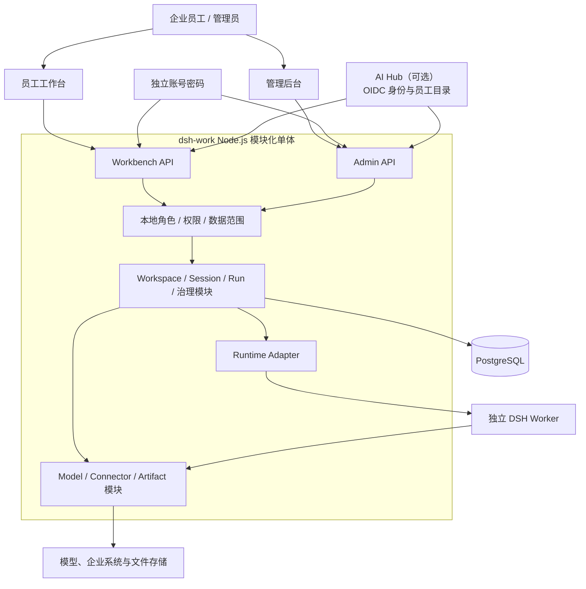

# dsh-work

> 面向企业员工的 AI Agent 工作台，基于 DeepSeek Harness（DSH），统一承载企业知识查询、受控工具、文件分析、项目协作、成果交付与运行治理。

## 项目背景

企业知识、业务数据和文件通常分散在知识库、ERP、MES 及员工本地工作环境中。员工需要在多个系统之间查询、整理和重复加工数据，通用 AI 工具又不能在缺少身份、权限、审计和数据边界的情况下直接访问企业资源。

dsh-work 为这些能力提供统一的企业级入口：员工以自然语言发起任务，平台在服务端识别身份和权限，调用经过治理的知识、业务工具与文件处理能力，并交付可追溯的回答、分析结果和文件成果。

## 产品定位

dsh-work 是面向企业员工的统一 AI Agent 工作台，同时提供独立的管理后台。员工工作台负责对话、项目空间、文件和成果体验；管理后台负责 Agent、Skill、MCP Connector、Runtime、权限、用量与审计治理。

平台负责身份、业务对象、权限、运行编排和审计事实。DSH 作为可替换的执行内核，只处理单次 Attempt 内的模型与 Tool 调用编排，不承担产品数据库、企业身份或长期业务凭据管理。

## 核心功能

- **统一对话：** 自然语言发起知识查询、业务查询与文件分析；全部 Agent 执行经 Run/Attempt → Runtime Adapter → DSH。
- **双模式员工端：** A 工作模式（新对话、Skill 广场、AI 同事、项目空间、定时任务）与 B 协作模式（对话、AI 同事、群组、定时任务）；模式按账号保存。
- **项目空间：** 人与 Agent 协同的项目简报、项目任务、共享讨论、成果与项目档案；Agent 可按版本开关管理项目任务。
- **文件与成果：** 上传和分析常见办公文件，保存来源、版本与下载权限。
- **定时任务：** 员工创建固定 Agent 版本的轻量自动任务，支持立即运行、启停与执行历史；不补跑停机遗漏、不自动重试。
- **Agent 与能力治理：** 管理端草稿 → 验证 → 发布；Skill、联网搜索、项目任务开关、MCP（`selected` / `none`）与模型路由版本化。
- **经验迭代：** Agent 经 `propose_memory` 提出经验申请，管理员审核后发布；员工端不再提供受控记忆入口。
- **身份与权限：** 独立账号密码登录；配置 AI Hub 后也可 OIDC 统一登录并同步员工目录；应用内配置角色、功能权限与数据范围。
- **审计与运营：** 运行、模型、MCP、成果与管理操作可追溯；提供用量、健康与异常追踪。

## 产品边界

- 企业系统接入以受控 Tool / MCP 为默认方式，不允许 DSH 直接连接 ERP/MES 数据库；
- 员工不能直接访问 DSH、任意 Shell、任意 SQL 或长期业务凭据；
- Tool、Connector 和模型能力由平台统一治理，不由员工绕过平台自行安装；
- 产品 Session、Run、文件、成果和权限事实由 dsh-work 持有，不依赖 DSH 内部对象；
- 逻辑模块用于划分职责和依赖，不默认拆分为业务微服务；
- **禁止第二套 Agent 执行引擎：** DSH 不可用时明确报告，不得降级为直接调用模型 API。

## 设计原则

- 一个入口：员工通过统一工作台使用企业 AI 能力；
- 服务端可信：身份、权限和操作人均由服务端建立，不能由浏览器声明；
- 版本不可变：已发布能力和运行快照可追溯，重试不会覆盖历史 Attempt；
- 最小权限：能力按 Allowlist 与数据范围收敛，敏感操作可审计；
- Runtime 可替换：业务对象只依赖稳定的 Runtime Adapter 和标准 Run Event；
- 默认可审计：运行和治理操作保留结构化、脱敏的审计事实。

## 架构概览



两个 Vue 应用独立构建并使用两个 API Audience；服务端长期保持模块化单体。每个 Attempt 默认使用独立 DSH Worker 子进程。完整设计见 [产品与系统架构总览](docs/development/overview.md)。

## 仓库结构

```text
apps/
├── workbench-web          # 员工工作台（Vue 3）
└── admin-web              # 管理后台（Vue 3 + Element Plus）
packages/                  # Design Token 与共享无状态组件
server/                    # Node.js / TypeScript 模块化单体
├── migrations/            # PostgreSQL 显式迁移
└── src/modules/           # 领域、应用与适配器模块
docs/                      # index、development、release、design
scripts/                   # 校验、Runtime 探针、CI 与发布部署
e2e/                       # Playwright 冒烟与验收目录
```

## 本地启动

使用 Node.js 22.19+ 或 24+，以及根目录 `package.json` 指定版本的 pnpm，先在项目根目录安装依赖：

```bash
pnpm install --frozen-lockfile
```

服务端始终使用 PostgreSQL 和账号登录（独立账号密码；配置 AI Hub 后也可统一登录），没有免数据库的内存模式。按 [开发与测试](docs/development/development.md) 准备数据库、`.env` 和首个管理员账号后执行：

```bash
pnpm dev:all
```

也可分别启动：

```bash
pnpm dev:server
pnpm dev:workbench
pnpm dev:admin
```

默认访问地址：

- 后端：`http://localhost:4190/health`
- 员工端：`http://localhost:4174/workbench`
- 管理端：`http://localhost:4180/overview`

常用验证：`pnpm test:e2e`（P0 冒烟）、`pnpm ci:static`、以及 [开发与测试](docs/development/development.md) 中的分层命令。浏览器旅程索引见 [e2e/TEST-CATALOG.md](e2e/TEST-CATALOG.md)。

## 文档

| 用途 | 入口 |
| --- | --- |
| 文档导航与维护规则 | [docs/index/README.md](docs/index/README.md) |
| 架构与未完成事项 | [架构总览](docs/development/overview.md) |
| 产品与安全规则 | [功能规则](docs/development/feature-rules.md) |
| Agent 设计与生命周期 | [设计规范](docs/development/agent-design-standard.md)、[生命周期模板](docs/development/agent-lifecycle-template.md) |
| 本地开发与测试 | [开发与测试](docs/development/development.md) |
| 数据模型 / 内部契约 | [数据模型](docs/design/data-model.md)、[内部端口](docs/development/internal-ports.md) |
| 身份与部署 | [独立登录](docs/release/local-authentication.md)、[AI Hub](docs/release/ai-hub-sso-integration.md)、[Mac mini 部署](docs/release/mac-mini-deployment-runbook.md)、[DSH Runtime](docs/release/dsh-runtime-delivery.md) |
| 平台 P2 验收 | [PF-07 手册](docs/development/pf07-platform-acceptance.md) |

日常协作约束见根目录 [AGENTS.md](AGENTS.md)。接口、配置及部署操作统一在 `docs/` 维护；过期方案与一次性验收记录不进工作树，从 Git 历史查阅。
