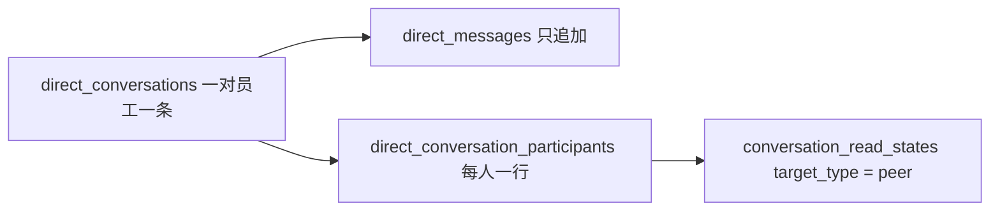

# 同事私聊

日期：2026-11-03  
状态：已实现（2026-11-03）。校验失败沿用工作台现有 422。PC 员工端未改。  
对照：

- 协作模式对话对象：`docs/design/project-space-plan.md` 第 12 节，D20、D23、D24、D26
- 群里已有的人聊：`docs/development/feature-rules.md` §3.4（共享讨论；普通消息不产生 Run）
- 未读：功能规则 §2.2b，表 `conversation_read_states`（迁移 0101）
- 数据归属：`docs/design/data-model.md` §4（`sessions` / `messages` 必须归属空间）

本文定义同事之间一对一私聊的行为、权限和存储不变量。实施步骤见 [26-11-03 人与人聊天 实现计划](../实施计划/26-11-03 人与人聊天.md)。

确认本文前，下列取舍视为本方案的默认决定。任一条被改掉，存储和入口都要重写，不能只改文案。

| 编号 | 默认决定 |
| --- | --- |
| H1 | 本期只做两名员工的私聊。三人及以上的人聊继续使用项目空间共享讨论 |
| H2 | 同一租户内两名员工全局只有一条私聊，按时间连续显示，不拆话题 |
| H3 | 私聊不归属个人空间，也不建成项目空间 |
| H4 | 私聊消息不进入 `sessions` / `messages`，不创建 Run，不调用 DSH |
| H5 | 本仓库只增加工作台后端接口，供移动端 `dsh-work-mobile` 调用。不改 PC 员工端 `apps/workbench-web` |
| H6 | 本期纯文本。不传文件，不 @同事，不 @Agent，不能把私聊升级成项目空间 |

## 1. 要解决的问题

员工已经能在项目空间里互相讨论：普通消息写入共享讨论，只有 @Agent 才执行。协作模式把「与某个 AI 同事的单聊」和「某个群组」放进同一列表。D23 明确不做员工之间的私聊，因此两个人想单独说话时，只能新建一个至少包含一名 Agent 的群组。

本期补上这一条：任意两名在职员工可以有一条只有他们两人可见的私聊。页面在移动端做；本仓库提供读写接口。发送和阅读都不经过 Agent。PC 员工端继续只显示与 AI 同事的单聊和群组。

## 2. 范围

### 2.1 本期做

1. 移动端用现有 `GET /member-candidates` 选在职同事（排除本人）。本仓库不另做同事目录。
2. 两人之间已有私聊时直接打开；没有则在发出第一条消息时创建。空的、尚未发言的私聊不出现在私聊列表里。
3. `GET /me/direct-conversations` 返回本人可见的私聊，按最近活动倒序。每行有对方用户 id、姓名、最后一条预览、时间、未读数、对方是否仍可发消息。移动端自行与 AI 同事、群组混排。本接口不并入 `GET /me/conversation-targets`。
4. 打开私聊可按游标阅读历史。发送只追加一条本人消息。
5. 未读按「账号 + 对方用户 id」计，只进不退。对方的新消息计入未读；本人发出的不计。
6. 本人可以隐藏自己的这一行。隐藏不删除消息，对方列表保持不变。对方再发来一条时，本人列表重新出现该私聊，历史仍在。
7. 对方账号停用后，历史仍可阅读，`canSend` 为 false，再发送返回 422。停用账号不会出现在 `GET /member-candidates` 里，也不能新建私聊。
8. 对方新消息走现有协作未读推送（`collab_unread`，`targetType = peer`）。静音、角标、通知中心不单做。

### 2.2 本期不做

- 不做人聊群，不增加「无 Agent 的群组」，不放宽「新建项目空间必须选择至少一名 Agent」。
- 不改 PC 员工端页面、路由、对话列表和模式映射。`apps/workbench-web` 本期零改动。
- 不改 `GET /me/conversation-targets` 的返回种类（仍只有 `agent` 与 `group`），避免 PC 把对方用户 id 当成群组打开。
- 不改项目空间共享讨论、@同事提醒、@Agent 执行、任务对话和个人空间里与 AI 同事的会话。
- 不在本仓库实现移动端页面。移动端怎么挂到通讯录「真人」和对话列表，由 `dsh-work-mobile` 另做。
- 不传附件、不引用「我的文件」或成果、不 @、不转发、不撤回、不编辑已发送消息。
- 不把私聊消息交给任何 Agent，不写入 `conversation_history`，不产生会话摘要。
- 不做已读回执（「对方已读」），不做正在输入，不做端到端加密。
- 不提供管理端查看私聊正文。平台管理员身份不因此获得这两名员工的消息内容。
- 不物理删除消息。账号停用沿用现有登录撤销，不把私聊转交给他人。

## 3. 目标行为

| 场景 | 现在 | 改后 |
| --- | --- | --- |
| 两名员工想单独说话 | 移动端通讯录里的真人只能看简介，提示去群组 | 移动端调用新接口发私聊；发出第一条后双方都能在私聊列表里看到 |
| 再次找到同一同事 | — | 打开同一条私聊，历史连续 |
| PC 协作模式对话列表 | AI 同事与群组 | 仍然只有这两类。私聊不出现在这张列表里 |
| 在群里讨论 | 共享讨论；普通消息不执行 | 保持不变 |
| 与 AI 同事单聊 | 个人空间会话，按 Agent 聚合 | 保持不变 |
| 从自己的列表移除 | — | 只对自己隐藏；对方再发言则重新出现，消息都还在 |

## 4. 谁可以和谁聊

| 条件 | 结果 |
| --- | --- |
| 同一租户、对方是 `GET /member-candidates` 能返回的在职员工 | 可以打开、发送 |
| 对方已停用，且两人已有消息 | 启用中的一方可阅读，`canSend` 为 false，再发送返回 422 |
| 对方已停用，且从未有过消息 | 不能创建 |
| 自己与自己 | 拒绝 |
| 其他租户、不存在的用户标识 | 404，不透露该标识是否属于别的租户 |
| 非这两名参与者（含平台管理员以管理端身份调用） | 员工端接口只认当前登录员工；读不到这条私聊 |

选人继续用 `GET /api/workbench/v1/member-candidates`：在职、有员工工作台权限、排除当前用户。本期不改这个接口的字段和分页。

## 5. 移动端怎么用这些接口

本仓库不实现这些页面。移动端按下面的约定接；PC 不接。

- 通讯录「真人」仍来自 `GET /member-candidates`。点一名同事时先 `GET /direct-conversations/with/:userId`。`conversation` 为 null 时展示空态，发送第一条再创建。
- 对话列表把 `GET /me/direct-conversations` 与现有 `GET /me/conversation-targets` 在客户端按 `lastActiveAt` 合并。私聊行用对方用户 id 定位，地址建议为 `/c/chats/peer/:userId`。
- 输入为纯文本，空白不发送，长度 1～20000 个字符。`canSend === false` 时不展示输入区，说明「对方账号已停用」。
- 打开且页面可见时调用已读接口。隐藏只影响本人列表。
- 推送点击使用载荷里的 `url`（`/c/chats/peer/:userId`）以及 `targetType = peer`、`targetId = 对方用户 id`。`sessionId` 填私聊 id，它不是产品 Session，不能拿去调 `GET /sessions/:id`。

## 6. 数据怎么存

私聊不是空间里的会话。`sessions` 必须带 `workspace_id`，个人空间只有主人，项目空间会带上成员、任务、文件和 Agent 规则。把私聊写进其中任一处，都会让另一人读到不该读的空间，或让一条人话进入 Agent 的上下文。因此私聊单独成表，与 `sessions`、`messages`、`runs` 无外键。



### 6.1 `direct_conversations`

一条记录表示两名员工的唯一私聊。

| 列 | 约束 |
| --- | --- |
| `id` | 应用生成的主键 |
| `tenant_id` | 租户 |
| `user_low` / `user_high` | 两名员工的用户 id，按字符串升序放入，`user_low < user_high` |
| `created_by` | 发出第一条消息的人 |
| `created_at` | 创建时间，即第一条消息写入的同一事务 |
| `last_message_at` | 最新一条消息的 `created_at`，与插入消息同一事务更新 |

唯一约束：`(tenant_id, user_low, user_high)`。并发下两人同时发出第一条时，只有一条会话被创建，另一条消息写入同一会话。

### 6.2 `direct_messages`

| 列 | 约束 |
| --- | --- |
| `id` | 主键 |
| `tenant_id` | 与会话相同 |
| `conversation_id` | 所属私聊 |
| `sender_user_id` | 必须是两名参与者之一 |
| `content` | 去首尾空白后 1～20000 字符的纯文本 |
| `created_at` | 写入时间，只追加 |

没有 `role`、没有 `run_id`、没有 `agent_version_id`。消息发出后不可修改、不可单条删除。

### 6.3 `direct_conversation_participants`

每个参与者一行，主键 `(tenant_id, conversation_id, user_id)`。

| 列 | 含义 |
| --- | --- |
| `user_id` | 两名员工之一 |
| `hidden_at` | 本人从列表移除的时间；空表示列表中可见 |

对方新消息的 `created_at` 晚于本人的 `hidden_at` 时，列表再次显示，并清掉 `hidden_at`。隐藏不改变消息，也不改变对方的行。

### 6.4 已读

继续用 `conversation_read_states`。`target_type` 增加 `peer`，`target_id` 为**对方的用户 id**（与列表行的 `id` 一致，不是会话 id）。未读 = 对方发出的、`created_at` 晚于 `last_read_at` 的消息数，最多计到 100。没有已读记录时从第一条消息计起。标记已读只前进。已读走 `POST /direct-conversations/with/:userId/read`，不扩展 `POST /me/conversation-targets/:type/:id/read` 的 `agent | group` 校验。

上线时没有历史私聊，不做「全部记为已读」的回填。

### 6.5 明确不写入的地方

| 现有表 | 原因 |
| --- | --- |
| `sessions` / `messages` | 归属空间，并会进入 Agent 上下文与会话摘要 |
| `workspaces` / `workspace_members` | 私聊不是项目空间，也不占用个人空间 |
| `message_mentions` | 本期没有 @ |
| `runs` / `tasks` | 发送不产生执行 |

内容保留与功能规则 §2.3 一致：本期没有物理删除和到期销毁。

## 7. 接口

前缀 `/api/workbench/v1`，信封与现有工作台一致：`{ "data": ..., "meta": { "api": "workbench", ... } }`。列表沿用对话对象的游标分页，不用另一套 `page` / `pageSize`。

| 方法 | 路径 | 行为 |
| --- | --- | --- |
| `GET` | `/me/direct-conversations` | 本人未隐藏的私聊。查询参数 `cursor`、`limit`（默认 30，最大 100）。`data` 为 `{ items, nextCursor }` |
| `GET` | `/direct-conversations/with/:userId` | 已有私聊时返回对方资料、`conversationId`、`canSend`；尚无消息时 `conversation` 为 null，对方在职则 `canSend` 为 true |
| `GET` | `/direct-conversations/:id/messages` | 参与者按时间游标读取；非参与者 404。`data` 为 `{ items, nextCursor }` |
| `POST` | `/direct-conversations/with/:userId/messages` | 正文 `{ "content": "..." }`。同一事务内保证唯一会话并追加消息。成功 `data` 为 `{ id, conversationId, senderUserId, content, createdAt }` |
| `POST` | `/direct-conversations/with/:userId/read` | 已读位置只进不退。尚无私聊时 404。`data` 为 `{ userId, lastReadAt }` |
| `POST` | `/direct-conversations/:id/hide` | 只写本人的 `hidden_at`。`data` 为 `{ id, hidden: true }` |

列表项：

```json
{
  "type": "peer",
  "id": "对方用户 id",
  "conversationId": "私聊 id",
  "name": "对方姓名",
  "lastMessage": { "authorName": "发送者姓名", "text": "最多 120 字", "sentAt": "ISO 时间" },
  "lastActiveAt": "ISO 时间",
  "canSend": true,
  "unreadCount": 0
}
```

`id` 是对方用户 id，方便移动端用通讯录里的同一个人定位。`lastMessage` 在没有消息时不会出现在列表中，因为没有消息的私聊不会被创建。

发送成功不调用 `POST /sessions/:id/runs`。对方停用、内容空白或超长返回 422，`error.message` 可直接展示。不新增 SSE。刷新频率由移动端决定。

系统通知：对方新消息使用现有 `collab_unread`。`tag` 为 `collab:peer:{对方用户 id}`，`targetType` 为 `peer`，`targetId` 为对方用户 id，`url` 为 `/c/chats/peer/{对方用户 id}`，`sessionId` 为私聊 id。正文最多 120 字。本人自己发出的消息不通知自己。订阅表不区分 PC 与手机，因此该用户已有的 PC 订阅也会收到这条推送；PC 没有对应页面，点击后的落点不在本期验收内。

## 8. 权限与失败

- 所有写操作只认员工端当前登录账号，服务端用会话确定发送者，不接受客户端传入的 `senderUserId`。
- 读取消息、标记已读、隐藏，都先确认当前用户是两名参与者之一；否则 404。
- 停用账号的登录会话仍按现有规则撤销，其私聊接口不可用。
- 列表预览和通知正文不带 Cookie、令牌或其他私聊的原文。

## 9. 验收

1. 甲向在职的乙发出第一条消息后，甲、乙的 `GET /me/direct-conversations` 都有这一行，消息内容一致。`GET /me/conversation-targets` 的种类仍只有 `agent` 与 `group`。
2. 乙回复后，甲的该行 `unreadCount` 增加；甲调用已读接口后未读变为 0，且不能把已读时间拨回。甲自己的消息不增加甲的未读。
3. 甲再次向乙发送，仍写入同一 `conversationId`，历史按时间连续。
4. 甲隐藏后，自己的列表不再返回该行，乙的列表和消息都还在。乙再发一条后，甲的列表恢复，且能读到隐藏前的消息。
5. 将乙停用后，甲仍能读取历史，`canSend` 为 false，再发送返回 422。
6. 员工丙读取这条私聊的消息，得到 404，响应里没有正文。
7. 发送私聊消息后，`sessions`、`messages`、`runs` 的行数不增加。
8. 项目空间讨论、@Agent 执行、与 AI 同事的单聊，接口行为与本期之前一致。PC 员工端源码无改动。
