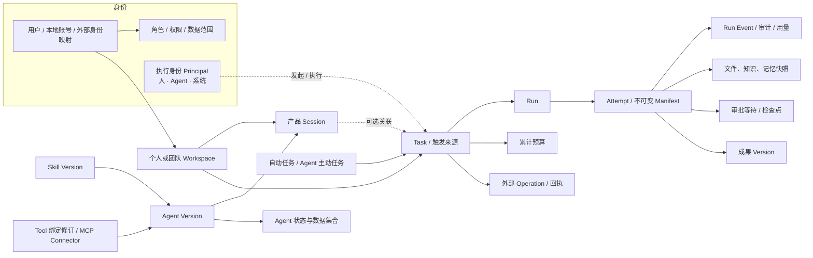
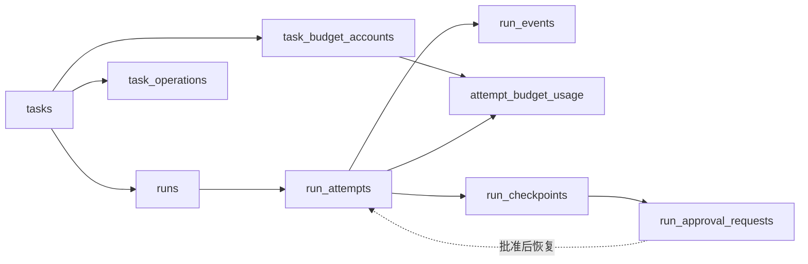

# 数据模型

PostgreSQL 是产品事实来源。本文按领域说明表的作用、关系和不变量；准确字段、索引、外键及升级顺序以 [SQL 迁移](../../server/migrations/) 为准，不维护另一份 DDL 副本。

当前共 93 张表和 1 个视图（不含迁移记录表 `schema_migrations`）。几乎所有表都以 `(tenant_id, id)` 为业务键，跨表外键带 `tenant_id`，所以引用不会跨租户；MVP 只有一个租户 `tenant-dsh-work`。`pnpm verify` 检查迁移创建的每张表都在本文出现，新增表时同步补充所属领域。

## 领域总览

## 1. 租户、身份与授权

| 表 | 作用 | 关键不变量 |
| --- | --- | --- |
| `tenants` | 租户 | 新租户自动创建平台系统 Principal |
| `users` | 本地用户 | 主键稳定；AI Hub `external_user_id` 是外部稳定键，Subject 只是协议映射；新用户自动获得唯一默认个人空间与人类 Principal |
| `local_user_credentials` | 独立账号密码 | 用户名全租户唯一；密码以加盐 scrypt 保存；初始密码必须修改 |
| `local_identity_bootstrap` | 首个独立管理员的一次性初始化 | 每租户只能消费一次 |
| `local_auth_rate_limits` | 登录限流计数 | 键是 HMAC，不保存用户名或地址；多进程与重启共享 |
| `authentication_sessions` | 服务端 Session | 浏览器只持有不透明 Cookie，数据库只存摘要；OIDC Token 服务端加密 |
| `oidc_login_transactions` | OIDC 登录事务 | state、nonce 与入口绑定，一次性使用 |
| `application_admin_bootstrap_claims` | AI Hub 初始管理员认领 | 按应用/环境幂等消费 |
| `identity_directory_sync_state` | AI Hub 员工目录同步游标 | 持久化 opaque cursor；员工停用即撤销其 Session，保留本地角色历史 |
| `roles`、`user_roles`、`data_scope_grants` | 本地角色、用户角色、数据范围授权 | 独立于 AI Hub；过期角色不生效；任何变更由触发器递增本地授权版本，请求按当前版本重新计算 |
| `system_settings` | 早期的租户级设置 | 当前代码未读写 |

## 2. 执行身份

每次执行都区分“谁发起”和“以谁的身份执行”。执行身份（Principal）分三类：人、Agent、平台系统，由触发器随用户、Agent、租户创建自动生成。

| 表 | 作用 | 关键不变量 |
| --- | --- | --- |
| `execution_principals` | 执行身份 | 每个用户、Agent、系统键各唯一一个；`authorization_version` 随授权变化递增 |
| `agent_principal_role_grants`、`agent_principal_scope_grants` | Agent 自身的角色与数据范围授权 | 授权属于 Agent Principal 而非其治理负责人；Agent Version 声明的角色与范围是上限；增删改由触发器递增 `authorization_version` |

Task 创建时由触发器写入发起 Principal：员工请求为本人，系统任务为平台 Principal，Agent 主动任务为该 Agent 且要求规则仍启用、接收人一致；调用方不得自带执行者或审批者。Attempt 创建时触发器把执行 Principal 固定到 Manifest 声明的 Agent（无 Agent 时为平台 Principal），与 Manifest 的 `principal_context` 不一致即拒绝。

## 3. 工作空间与团队协作

| 表 | 作用 | 关键不变量 |
| --- | --- | --- |
| `workspaces` | 个人或团队空间 | 每位用户唯一默认个人空间；团队空间可归档，归档后只读 |
| `workspace_brief_versions` | 项目空间简报（迁移 0088） | 每次保存新增版本，最新版本即当前简报；任务线程的执行在 Manifest `project_context` 中固定所用版本 |
| `project_tasks`、`project_task_files` | 项目任务及其引用的共享文件版本（迁移 0088） | 业务层工作项，不复用执行层 `tasks`；Agent 任务以 `session_id` 关联任务线程，状态由最近一次 Run 推算；逻辑移除 |
| `workspace_archive_versions` | 项目档案（迁移 0089） | 条目数组，每次变更新增版本，来源为档案员（运行与依据任务）、手动编辑或回退；任务线程的执行在 Manifest `project_context.archive` 中固定所用版本 |
| `workspace_archive_inputs`、`workspace_archivist_state` | 档案员待整理成果与每空间整理状态（迁移 0089） | 任务完成时登记成果；整理批次认领后写入新版本或释放重试（失败 3 次放弃）；每个空间同一时间只有一次整理 |
| `workspace_members` | 空间成员与角色（owner、admin、member、viewer） | 个人空间成员关系受触发器保护；团队空间必须有且只有一名负责人（延迟约束触发器，违反时错误码 `DW001`） |
| `workspace_capability_grants` | 空间可用的 Agent、Skill、Tool 版本 | 团队资源按成员与能力授权，默认拒绝 |
| `workspace_grant_sources` | 能力授权的来源（Agent 成员、手工、历史未对账） | 一项授权可有多个来源；全部来源撤销后授权失效 |
| `workspace_agent_members` | 团队空间里的 Agent 成员 | 同一 Agent 在一个空间只有一条；固定到具体 Agent Version |
| `workspace_revocation_events` | 成员移除、角色变化、Agent 停用等收权事件 | 去重后持久排队，由撤权扫描取消已失权的运行，可重放 |
| `workspace_activity_events` | 团队动态（成员、Agent、文件、归档） | 按去重键幂等；元数据不含文件正文；会话附件不进入动态 |
| `workspace_notification_states` | 每位成员的已读位置与静音 | 已读时间只前进不回拨 |

## 4. 会话、Task 与运行

| 表 | 作用 | 关键不变量 |
| --- | --- | --- |
| `sessions`、`messages` | 产品会话与消息 | 必须归属空间；个人会话锁定 Agent Version，团队会话按消息绑定 Agent 成员；产品 Session 不等于 DSH Session |
| `session_summaries` | 长对话中段的摘要（EX-02） | 覆盖首条消息之后、到 `covered_through` 为止的消息；每个会话最多一条 pending；由无 Session 的 `session-summary` 运行生成，成功后不可修改，较新的摘要取代旧的 |
| `tasks` | 一次业务请求 | 按来源类型和关联键幂等受理；API/event 请求摘要不可漂移；可选关联 Session |
| `task_operations` | Task 的外部动作与回执 | 按 Task + 操作键唯一，参数摘要不可漂移；效果未知必须查询后收敛 |
| `runs` | Task 下的执行 | 每个 Run 必须归属 Task：会话 Run 未带 Task 时触发器自动创建，无会话 Run 必须显式提供；Run 状态变化由触发器同步到 Task |
| `run_attempts` | 一次实际执行 | 按序创建，Manifest 编译后以 SHA-256 锁定且不可变；重试新建 Attempt，不覆盖历史 |
| `run_events` | 运行事件 | 先落库再推送；按整个 Run 的持久化顺序续传 |
| `task_budget_accounts`、`attempt_budget_usage` | 累计预算与每个 Attempt 的预留/结算 | 预算范围默认是 Task 自身；Attempt 先预留后结算；Attempt 进入等待或终态而应用未结算时，触发器按时间戳兜底结算或释放 |
| `run_checkpoints` | 审批等待的恢复检查点 | 内容与摘要不可变；每次等待一个关联键；只能被一个恢复 Attempt 消费 |
| `run_approval_requests` | 动作审批 | 绑定动作、参数摘要、资源、执行身份、数据版本和有效期；决定只能写一次；批准后从检查点新建 Attempt |
| `approvals` | 早期的审批记录 | 已由 `run_approval_requests` 取代，当前代码未读写 |

## 5. Agent 与发布治理

| 表 | 作用 | 关键不变量 |
| --- | --- | --- |
| `agents`、`agent_versions` | Agent 与其版本 | 版本状态为草稿、待发布（`candidate`，验证时原地冻结）、已发布；待发布与已发布版本内容不可修改（触发器，待发布只能改为已发布）；版本记录精确的 Skill、Tool 引用，不含可见角色或数据范围；可见角色 `visible_role_ids` 属于 Agent，岗位角色与数据范围授予执行身份，都立即生效；新建 Agent 自动生成执行身份与数据平面安装记录 |
| `agent_test_cases` | Agent 的自定义测试问题 | 属于 Agent 而非版本，跨版本复用；每个 Agent 最多 20 条，按位置唯一 |
| `agent_validations` | 一次验证 | 绑定一个冻结的待发布版本（`candidate`）；每个 Agent 只有一个有效验证（`running`/`completed`），开始新验证时旧验证标为 `superseded`；发布后标为 `published` |
| `agent_validation_cases` | 验证案例及结果 | 开始验证时快照示例问题、主动任务输入与自定义问题；记录 Run/Attempt、运行次数、三项机器检查与判定；判为不通过必须有原因；服务重启时未完成的案例标为中断 |
| `agent_version_skills`、`agent_version_tools` | 早期的版本—能力关联表 | 当前引用保存在 `agent_versions` 上，这两张表未被读写 |

## 6. Skill

| 表 | 作用 | 关键不变量 |
| --- | --- | --- |
| `skills`、`skill_versions` | Skill 与其版本 | 已发布版本不可修改（触发器）；文件夹正文经存储端口按内容寻址保存，数据库只存引用与文件索引 |
| `skill_version_dependencies` | Skill 依赖 | 依赖精确版本，不能依赖自身；依赖不能扩大 Tool Allowlist |
| `skill_installations` | 管理端安装计划 | 每次安装 Run 一条；完成时必须指向已保存的版本 |
| `skill_test_bindings` | 严格试运行与精确 Attempt 的绑定 | 不可修改（触发器）；绑定配置与 Runtime 指纹 |
| `skill_runtime_activations`、`skill_python_executions` | Attempt 内的 Skill 激活与 Python 执行记录 | 作为试运行证据，按 Attempt 隔离 |
| `skill_release_records` | 发布、启用、停用、回滚记录 | 只追加 |
| `skill_test_runs` | 早期的测试记录 | 只保留历史 |

## 7. 工具、Connector 与凭据

| 表 | 作用 | 关键不变量 |
| --- | --- | --- |
| `tools`、`tool_versions` | 工具与版本 | 平台内置工具的审批策略由平台固定 |
| `tool_binding_revisions` | 工具绑定修订（执行器、端点、凭据、授权与审批策略） | 每次变更新增修订；Agent 版本与 Attempt 固定引用修订，撤销或漂移后执行前复核会拒绝 |
| `connectors`、`connector_health_checks` | 连接器与健康检查 | 健康状态与配置分离 |
| `mcp_connector_profiles` | MCP 连接器的发现结果与审核状态 | 只支持 Streamable HTTP；能力摘要变化需重新审核 |
| `credential_refs`、`credential_secrets` | 凭据引用与加密密文 | 密文为 AES-256-GCM；接口不回显、不导出密钥正文 |

## 8. 模型与 Runtime

| 表 | 作用 | 关键不变量 |
| --- | --- | --- |
| `model_providers`、`provider_models`、`model_routes` | Provider、模型与平台路由 | 只存凭据引用；路由只写入 Attempt 快照，实际模型由 DSH Profile 固定（仅记录）；没有可用路由时新运行被拒绝 |
| `runtimes`、`runtime_configurations` | Runtime 与其配置 | 健康与调度状态分离；配置追加版本；Runtime 不等于每次执行的 Worker |

## 9. 文件与成果

| 表 | 作用 | 关键不变量 |
| --- | --- | --- |
| `file_objects`、`file_extractions` | 不可变文件对象与解析结果 | 存储键不用用户文件名；字节经存储端口保存 |
| `run_input_files` | Attempt 的输入文件 | 每次 Attempt 固定原文件与解析版本，只读，执行前重新鉴权 |
| `workspace_files`、`workspace_file_versions` | 团队共享文件的逻辑文件与版本 | 新版本不覆盖不可变对象；逻辑移除保留历史；历史 Run 仍指向实际使用的对象 |
| `artifacts`、`artifact_versions` | 运行成果 | 新增版本，不覆盖旧文件；关联 Session 或 Task；下载检查空间、会话共享规则或 Task 所有人 |

## 10. 知识与记忆

| 表 | 作用 | 关键不变量 |
| --- | --- | --- |
| `knowledge_sources`、`knowledge_documents` | 知识来源与文档版本 | 已发布文档不可修改；来源、版本、生效日期、权限与摘要可追溯；合成来源显式标记 |
| `knowledge_chunks` | 检索分段 | 文档写入或草稿修改时由触发器按句切分（每段不超过 800 字）并生成中文二元组与英文词检索项，GIN 索引；检索先过滤权限再排序 |
| `run_knowledge_sources` | Attempt 引用的知识 | 记录相关度与摘录，用于回答末尾的引用 |
| `memory_proposals` | Agent 在运行中提出的短期记忆建议 | 只有人能确认范围与保留期后提交审核；按 Attempt + 提案键幂等 |
| `memory_consents` | 来源用户对记忆使用范围的授权 | 可撤回；撤回后不能再发布 |
| `memory_candidates` | 待审核的记忆候选 | 按提交人 + 提交键幂等；只能被处理一次 |
| `memory_entries`、`memory_versions` | 已发布的记忆与其版本 | 版本不可修改（触发器）；按可见范围（个人、空间、组织）与角色检索 |
| `run_memory_sources` | Attempt 引用的记忆版本 | 固定到具体版本 |

## 11. 自动任务与 Agent 主动任务

| 表 | 作用 | 关键不变量 |
| --- | --- | --- |
| `agent_automations` | 员工拥有的定时自动任务 | 固定 Agent Version 与空间；受理时以创建时的授权上限求交 |
| `automation_executions` | 每次触发 | 按任务 + 触发 ID 幂等；受理、跳过、中断三种结果；补跑记录缺失时间窗 |
| `agent_routines` | Agent 拥有的主动任务 | 需管理员批准角色与数据范围；接收人只是披露对象，不是发起人 |
| `agent_routine_executions` | 主动任务的每次触发 | 按规则 + 触发 ID 幂等；受理时必须同时关联 Task 与 Run |

## 12. 管理助手

| 表 | 作用 | 关键不变量 |
| --- | --- | --- |
| `admin_assistant_task_proposals` | 通用助手生成的委派提案 | 每个 Run 一条；内容以摘要锁定；确认后才启动专用助手 |
| `admin_assistant_action_plans` | 专用助手生成的写入计划 | 每个 Run 一条；以变更前状态与摘要锁定，状态已变化则拒绝执行 |

## 13. 审计、用量与运营

| 表 | 作用 | 关键不变量 |
| --- | --- | --- |
| `audit_events` | 管理与执行审计 | 可按用户、空间、Session、Run、Attempt 追踪；不含提示词、业务正文或密钥 |
| `tool_audit_logs` | 工具调用审计 | 只记录参数摘要 |
| `mcp_invocation_audits` | MCP 调用审计 | 按 Attempt + 调用 ID 唯一；参数只存摘要；结果未知需核对 |
| `model_usage_events` | 模型用量 | Token 来自 DSH 会话日志，缺失时标记不可用 |
| `operational_events`（视图） | 运营事件投影 | 只读投影，不含业务正文 |

## 数据库触发器

不变量尽量由数据库保证，应用逻辑出错也不会写出不一致的数据。

| 触发器（表） | 作用 |
| --- | --- |
| `agent_versions_immutable`、`skill_versions_immutable`、`knowledge_documents_immutable`、`memory_versions_immutable`、`skill_test_bindings_immutable` | 已发布版本与证据不可修改 |
| `users_personal_workspace_provisioning`（users） | 为新用户创建默认个人空间 |
| `personal_workspace_membership_guard`、`team_workspace_single_owner`（workspace_members） | 保护个人空间成员关系；团队空间必须有且只有一名负责人（`DW001`） |
| `roles_bump_local_authorization`、`user_roles_bump_local_authorization`、`data_scope_grants_bump_local_authorization` | 授权变化递增本地授权版本 |
| `users_create_execution_principal`、`agents_create_execution_principal`、`tenants_create_execution_principal` | 自动创建人、Agent、系统执行身份 |
| `agent_role_grant_version`、`agent_scope_grant_version` | Agent 授权变化递增其授权版本 |
| `tasks_assign_initiator_principal` | 按来源写入并校验 Task 发起身份 |
| `run_attempts_pin_task_executor_principal` | 把 Attempt 执行身份固定到声明的 Agent 或平台 |
| `runs_ensure_task_identity`、`runs_sync_task_status` | 会话 Run 自动建 Task；Run 状态同步到 Task |
| `runs_ensure_budget_account`、`run_attempts_settle_budget_fallback` | 建立预算账户；Attempt 结束时兜底结算或释放预留 |
| `knowledge_documents_index` | 知识文档写入时生成检索分段 |

## 运行终态与恢复

Run 和 Attempt 的普通状态转换不能从终态回退。只有失败或取消的 Run 接受显式重试：创建新 Attempt 并重新排队，原 Attempt 和事件保持不变。

服务重启将失去 Worker 的活动 Attempt 收敛为失败，只恢复尚未执行的排队 Manifest；审批等待和管理助手动作各自在启动时对账。浏览器使用稳定事件 ID 续传，不能用单 Attempt 的序号替代全 Run 顺序。

## 迁移入口

- [基础模型](../../server/migrations/0001_m2_platform.sql) 与后续运行、能力和文件迁移。
- [对象授权](../../server/migrations/0010_m4_authorization.sql)、[个人空间](../../server/migrations/0013_m5_personal_workspaces.sql)、[团队空间授权](../../server/migrations/0022_team_workspace_authorization.sql)。
- [服务端 Session](../../server/migrations/0014_m6_ai_hub_sso.sql)、[本地授权](../../server/migrations/0016_identity_owned_authorization.sql)、[业务员工](../../server/migrations/0017_business_user_directory.sql)、[升级对账](../../server/migrations/0018_fail_closed_directory_reconciliation.sql)、[独立账号](../../server/migrations/0077_local_identity.sql)。
- [多入口 OIDC 事务](../../server/migrations/0020_multi_origin_oidc.sql)、[团队共享文件逻辑移除](../../server/migrations/0024_workspace_file_removal.sql)、[逻辑文件与版本](../../server/migrations/0025_workspace_file_versions.sql)。
- [Agent 发布治理](../../server/migrations/0039_agent_release_governance.sql)、[自动任务](../../server/migrations/0040_agent_automations.sql)、[工具绑定修订](../../server/migrations/0047_tool_binding_revisions.sql)、[MCP 治理](../../server/migrations/0053_mcp_connector_governance.sql)。
- [PF-01 Task 与外部操作基础](../../server/migrations/0050_task_operation_foundation.sql)、[无 Session 执行与 Task Artifact](../../server/migrations/0051_session_neutral_task_execution.sql)、[累计预算](../../server/migrations/0052_task_cumulative_budgets.sql)。
- [持久化等待与审批](../../server/migrations/0061_persistent_wait_and_approval.sql)、[受控记忆](../../server/migrations/0062_controlled_memory.sql)、[执行身份](../../server/migrations/0064_execution_principals.sql)。
- [Agent 数据平面](../../server/migrations/0072_agent_data_plane.sql)（已由 0087 删除）、[Agent 主动任务](../../server/migrations/0074_agent_owned_routines.sql)、[负责人错误码](../../server/migrations/0080_workspace_owner_errcode.sql)、[知识分段检索](../../server/migrations/0081_knowledge_chunks.sql)。
- [删除 Agent 委派](../../server/migrations/0083_remove_agent_delegation.sql)：移除 `task_delegations` 与版本上的委派策略；历史子任务仍保留 `delegation` 来源类型，但不能重试。
- [Agent 级岗位权限](../../server/migrations/0084_agent_level_access.sql)：可见角色从版本迁到 Agent（取当前发布版本，未发布取草稿），删除版本上的可见角色与数据范围上限。
- [Agent 验证与发布](../../server/migrations/0085_agent_validations.sql)：版本增加待发布状态并冻结不可变；新增自定义测试问题、验证与验证案例；发布记录转为审计事件后删除候选、试运行、版本证据、Agent 包、早期测试与发布记录六张表。
- [Agent 运行记录索引](../../server/migrations/0086_agent_run_history_index.sql)：详情页按 Task 的执行身份读取最近 Run。
- [删除 Agent 数据平面](../../server/migrations/0087_remove_agent_data_plane.sql)：删除工作数据（集合、记录、提案、私有状态、安装实例）共 11 张表；旧版本定义中的 `data` 声明不再读取。

新增变更使用新的顺序迁移，保留已应用迁移；迁移运行器以咨询锁串行执行并校验已执行迁移的 SHA-256，修改已执行迁移会拒绝启动。应用回滚不会自动降低 Schema，至少保持上一版本兼容；破坏性清理需独立安排。操作流程见 [部署手册](../release/mac-mini-deployment-runbook.md)。

## 数据保留与安全

模型隐藏推理和密钥不进入数据库、日志或 SSE。消息正文与运营审计分开管理；管理端治理摘要不等于开放全量业务消息读取。文件进入 Runtime 前执行权限、类型和路径校验，企业扫描、保留期、备份与清理策略需要按环境落实。数据库与 `DSH_WORK_DATA_ROOT`（上传文件、成果、Skill 文件）必须成组备份和恢复。

完整契约见 [内部端口与契约](../development/internal-ports.md)，回归和真实验收要求见 [开发与测试](../development/development.md)。
