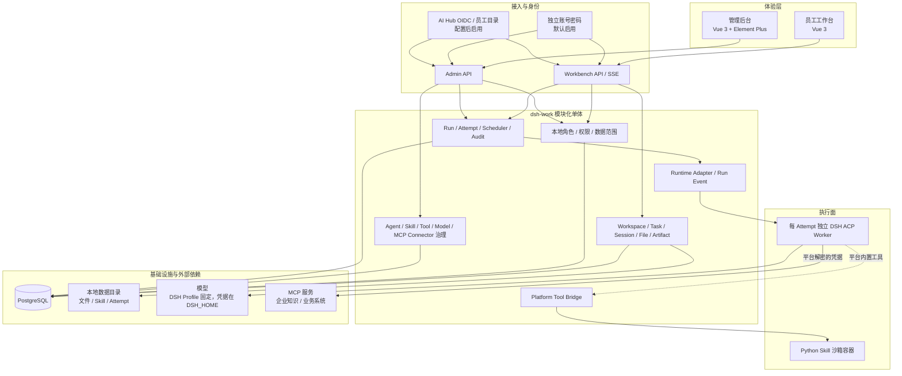
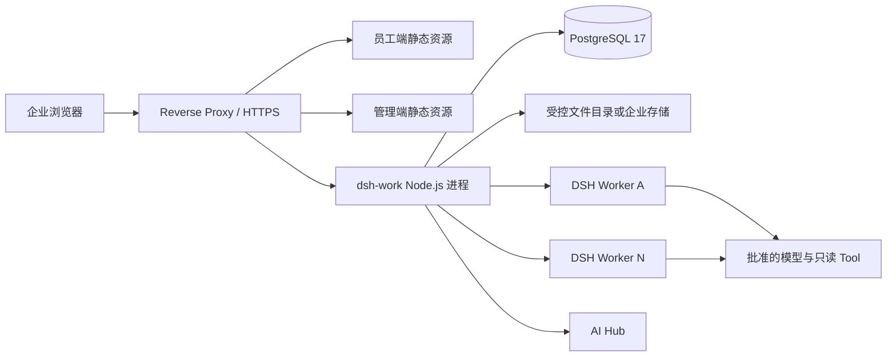

# dsh-work 产品与系统架构总览

**文档状态：** 当前架构基线 
**更新日期：** 2026-10-15 
**技术形态：** 两个独立 Vue 应用 + 一个 Node.js 模块化单体 + PostgreSQL + 独立 DSH Worker 进程 
**身份来源：** 独立账号密码（`local`）、AI Hub OIDC（`oidc`）；测试身份只存在于测试代码中

本文统一描述 dsh-work 的产品范围、系统边界和长期架构。接口字段、物理表和验证命令不在本文重复维护，分别以可执行契约、SQL 迁移和开发测试指南为准。

Agent 定义、能力依赖、状态、授权、发布和评测的通用要求统一见 [Agent 设计规范](agent-design-standard.md)；新 Agent 按[通用 Agent 全生命周期模板](agent-lifecycle-template.md)推进；已交付功能的产品与安全规则见[功能规则](feature-rules.md)，未完成事项见第 10 节。本文保留系统职责与执行链的架构边界。

## 1. 产品定位与范围

dsh-work 是部署在企业内网的统一 AI Agent 工作台。员工通过自然语言使用经过授权的企业知识、业务数据和文件处理能力，获得带来源的回答、分析结论和可下载成果；平台管理员通过独立管理后台维护 Agent、Skill、预置 Tool/Connector、Runtime、权限、用量和审计。

MVP 聚焦三类业务场景：

1. 企业知识查询，回答带来源、版本和权限过滤；
2. ERP、MES 等企业系统的只读业务查询；
3. PDF、DOCX、XLSX、CSV、TXT、Markdown 文件的基础分析与成果交付。

MVP 明确不包含：

- 员工自建 Tool、Connector、插件或 MCP；
- 任意 Shell、任意 SQL 或 DSH Web UI 直达（执行容器内的受控单次 `bash` 已实现但随执行容器模式默认关闭，Mac mini 验收前不在生产开启，见[执行隔离方案](../design/execution-isolation-plan.md)）；
- 写入 ERP/MES 等高风险业务操作；
- PPT 生成、开放式 Agent 市场和跨企业多租户 SaaS；
- 为了形式上的“平台化”拆分业务微服务。

## 2. 责任边界

| 系统 | 负责 | 不负责 |
|---|---|---|
| dsh-work | 员工体验、Workspace、产品 Session、Run/Attempt、文件、成果、对象权限、运行编排、审计和运营 | 模型内部推理、企业身份主数据、企业系统业务规则 |
| DSH | 单次 Attempt 内的 Agent Loop、Skill 执行、模型/Tool 调用编排、取消和运行事件 | 产品数据库、长期身份、对象权限、业务凭据和企业系统直连 |
| AI Hub | OIDC 身份、环境初始管理员一次性 Bootstrap、基础员工资料与增量员工目录 | dsh-work 的角色、功能权限、数据范围、Session、业务对象和运行状态 |
| 企业系统/模型/存储 | 权威业务数据、模型能力、文件与备份基础设施 | dsh-work 的交互、编排和审计语义 |

关键边界：

- DSH Runtime Session 不等于 dsh-work 产品 Session；
- PostgreSQL 是产品元数据、权限、版本关系和运行状态的事实来源，浏览器 Store、DSH Session Log 和缓存不能替代它；
- Skill 的 `SKILL.md`、参考文件和脚本保存在 `DSH_WORK_DATA_ROOT/skills` 的内容寻址文件夹中；PostgreSQL 只保存相对引用和校验索引，数据库与该数据目录必须成组备份和恢复；
- 企业身份由服务端建立，浏览器传入的用户、角色或操作人字段不能作为授权事实；
- DSH 只能通过受控适配器和平台能力调用模型、Tool 与成果存储；
- MCP 复用 Connector 控制面，Agent Version 按整个 Connector 显式选择（`selected`，默认 `none`）；新增或输入 Schema 变化的 MCP Tool 须管理员确认后才生效；实际 Tool 调用由 DSH 完成并逐调用审计，不复制为平台 Tool Version/Binding；
- 使用 AI Hub 账号时，上游不可用不得绕过登录、Token 刷新或员工目录同步；已有 Session 只在 Access Token 尚未进入刷新窗口时独立使用本地授权，不能把 Session 有效期等同于离线可用时长。

## 3. 架构原则

### 3.1 逻辑边界稳定，物理部署简单

员工工作台、管理后台、身份、Workspace、治理、运行、Runtime Adapter、Model 治理、MCP Connector 控制面、Artifact 和审计是清晰的逻辑边界，但不等于独立服务。MVP 和生产默认都保持一个代码库、一个 Node.js 业务部署单元和一套共享业务事实。

只有以下边界采用独立运行体：

- 员工工作台与管理后台分别构建静态资源；
- 每个 Attempt 默认启动独立 DSH ACP Worker 子进程；
- PostgreSQL、模型 Provider、企业系统和文件存储是外部依赖；AI Hub 仅用于其账号的登录与目录同步。

### 3.2 版本不可变、运行可追溯

已发布 Agent Version、Skill Version、Tool Version 和 Attempt Manifest 不可覆盖。每个 Run/Attempt 固定实际使用的版本、模型路由快照、权限范围、输入文件和来源快照，重试创建新 Attempt，不修改历史 Attempt。

### 3.3 只读与最小权限优先

企业 Connector 首期只读；Tool 必须进入 Allowlist 并经过角色、数据范围、工作空间和版本授权。敏感字段在进入模型或日志前过滤，密钥正文不进入业务数据库、Manifest、前端响应或审计详情。

### 3.4 产品事实与执行轨迹分离

dsh-work 保存可面向用户和治理的业务状态；DSH 保存运行时技术轨迹。ACP 负责程序化控制和已提交回答，允许进入平台的 Tool、Token、时延和状态字段必须经过显式脱敏投影。

### 3.5 Agent 执行引擎统一

所有 Agent 场景统一使用 DeepSeek Harness（DSH），包括员工对话、管理端对话安装 Skill 和其他系统助手。调用路径统一为：前端 → 对应 Audience 的 API → 平台 Run/Attempt → Runtime Adapter → DSH。各场景可以有独立的业务状态、Agent 配置和工具授权，但必须复用同一条执行链路。

- **禁止第二套 Agent 执行逻辑。** 不得在前端、业务后端或独立服务中绕过 DSH，直接调用模型 API 实现 Agent 对话、工具调用循环、多步推理、模型上下文推进或循环内重试；不得为安装助手等场景另引入并行 Agent 执行框架。
- **DSH 持有单次 Attempt 内的执行循环。** 模型交互、工具调用编排与循环上下文由 DSH 负责；平台复用现有 Runtime Adapter 处理启动、取消、超时、事件转换和进程回收。
- **平台持有业务事实和工具实现。** 身份与权限、会话和安装记录、队列调度、Attempt 重试、断线恢复、幂等及审计由平台负责。下载、解包、校验、入库和版本发布是受控业务工具；其确定性流程与事务恢复不属于另一套 Agent Loop。管理端安装工具按管理身份授权，不扩大员工 Agent 的工具权限。
- **暂不提供 Agent 委派。** 原 PF-06 `delegate_agent` 已于 2026-10-16 删除；AI 员工之间需要交接工作时再按 AI 员工交接场景重新设计。历史委派子 Task 保留记录但不能重试。
- **模型治理不承担 Agent 执行。** Model 模块只承担路由、凭据引用和计量等治理职责，不能自行发起一条绕过 DSH 的业务 Agent 路线；当前路由也尚未传给 DSH（见 4.4）。
- **DSH 不可用时禁止绕过。** 需要 Agent 的对话和试运行明确报告不可用，不能自动降级到直接调用模型。已有安装记录和确定性平台管理操作可按自身权限继续工作；这不代表 Agent 仍可运行。
- **扩展现有链路。** 安装助手所需工具调用或资源能力不足时，应扩展现有 Run/Runtime 契约和 DSH 能力。Runtime 可替换表示通过既有端口统一迁移执行内核，不表示允许各业务场景自行选择或维护第二套引擎。Mock Runtime 仅供测试与原型使用，不是生产回退方案。

新增 Agent 功能评审必须追踪到实际 DSH 调用和工具结果回传路径，并检查 Run/Attempt、权限、取消、重试和审计接线。设计稿、安装入库或 Mock 测试通过不能替代真实 DSH 执行验证。本约束同时由仓库根目录 [AGENTS.md](../../AGENTS.md) 提供开发入口。

### 3.6 工具分类与管理边界

运行时统一通过 DSH 发起工具调用。工具分两类管理：

- **内置工具**（DSH 原生工具与 dsh-work 平台工具）随代码发布，[注册表](../../server/src/modules/runtime/builtin-tools.ts)是唯一来源，不是可管理的数据，没有目录同步、逐工具授权或绑定修订。每个 Agent 运行默认获得工作区文件与任务进度工具（`read`、`glob`、`grep`、`read_image`、`write`、`edit`、`str_replace_editor`、`todo_write`），由执行策略限制在当前 Run 工作区和 output 目录；联网搜索 `web_search` 与项目任务管理（`project_tasks_*`）由 Agent 版本开关决定——后者仅在团队空间由人发起的运行中装配（定时执行只装配读工具）；激活 Skill、Python 执行和经验申请按运行内容装配；管理工具按 Run purpose 注入。`bash` 只在执行容器模式启用且本次启动检查通过时，由平台为员工侧 Agent 运行（对话、定时任务、发布试运行）装配，在每 Attempt 的断网执行容器中前台单次执行；系统与管理运行不装配，Skill 不能声明，模式未开启时不出现在模型可见工具中。注册表以外的工具（如 `web_fetch`、后台任务 `job_*`、Agent 协作与 Runtime 控制工具）一律不放行。管理员只能在 Runtime 配置中紧急停用 DSH 工具：新运行不再装配，执行中的运行再调用该工具时只拒绝这一次调用并告知模型，运行本身不中断。模型只看到本次运行放行的工具。管理端在 `安全与运维 → Runtimes` 只读展示内置工具、启动时与 DSH 工具目录的核对结果，以及执行容器状态（决定是否装配 `bash`）。
- **MCP 外部工具**以 Connector 为管理单元，由 Agent Version 显式选择；登记时发现的清单即生效，之后新增或输入 Schema 变化的 Tool 须管理员确认，入口为 `MCP 连接器`。

该分类不改变执行职责：DSH 仍持有单次 Attempt 的 Agent Loop；Platform Tool Bridge 只提供确定性处理器；MCP Connector 不进入内置工具注册表，内置工具也不能借 Connector 配置扩大用途。

## 4. 逻辑架构

DSH 直接调用模型并直连 MCP 服务，平台不设模型或连接器网关。平台控制的是 DSH 能用什么：工具白名单、工作区路径、执行中的授权复核和逐调用审计。平台内置工具与 Python 沙箱经 Platform Tool Bridge（Unix Socket）回到服务端执行。

### 4.1 体验层

- `apps/workbench-web`：A 工作模式主导航提供新对话、Skill 广场、AI 同事、项目空间和定时任务，B 协作模式主导航提供对话、AI 同事、群组和定时任务（模式为用户偏好，见[项目空间方案第 12 节](../design/project-space-plan.md)）；历史对话、我的文件及用户设置保留路由与上下文入口。默认个人 Workspace 隐藏在后台，旧链接与数据归属保留，见[功能规则第 2 节](feature-rules.md#2-个人工作区与内容)；
- `apps/admin-web`：运营、Agent、Skill/Tool、Runtime、Session、权限、模型用量、审计和健康；
- 两个应用拥有独立路由、Pinia、API 客户端、DTO 和构建产物；
- `packages/` 只共享 Design Token 和无业务状态组件，不共享认证状态或业务 Store。

### 4.2 接入与应用层

- `/api/workbench/v1` 与 `/api/admin/v1` 是两个独立 Audience；
- `/auth/workbench/*` 与 `/auth/admin/*` 分别完成登录、回调和退出；
- 服务端在 API 边界建立身份，随后由应用服务执行对象级和数据范围授权；
- `/api/workbench/v1/task-executions` 为 API/event 提供无产品 Session 的 Task 入口，仍复用同一 Run/Attempt 与 DSH 执行链路，并可在受理时固定 Task 累计预算；
- Run 编排、Agent/Skill/Tool 治理、知识、文件、模型、运营和身份模块都位于同一 Node.js 模块化单体。

### 4.3 Runtime 与执行层

- Runtime Adapter 只依赖固定的 ACP JSON-RPC stdio 协议；
- Runtime Manifest 使用规范化 JSON 与 SHA-256 固定运行输入；
- Runtime Manifest 同时固定 Task 预算范围、累计上限和本 Attempt 预占；PostgreSQL 在 Attempt 创建事务中完成并发预算检查，终态结算或释放预占；
- 一个 Attempt 默认对应一个隔离目录和一个 DSH Worker 进程；
- Adapter 负责启动、取消、超时、回收、事件转换和错误分类；
- 调度容量、排空/停用、重启恢复和 SSE 游标由 dsh-work 持久化控制。

### 4.4 平台能力层

- Model 模块保存 Provider、模型和路由策略，只持久化凭据引用。**当前路由只记录、不生效**：DSH ACP 使用 Profile 固定的模型（`deepseek-v4-pro`），凭据由 DSH 在 `DSH_HOME` 中管理；平台路由只写入 Attempt 快照，不决定实际调用的模型；Manifest 声明了模型能力要求的运行会被拒绝（`MODEL_CAPABILITY_UNAVAILABLE`）。让路由真正生效需要把它作为每次 Attempt 的配置传给 DSH；
- Connector/Tool 模块保存版本、Schema、风险、角色、数据范围和健康状态；
- Artifact/Content 模块保存文件与成果元数据、不可覆盖版本、权限和存储键；
- 审计与运营投影不保存提示词、回答正文、文件内容或密钥正文。

## 5. MVP 物理部署

目标 MVP 以公司内网 Mac mini 为单节点部署基线：Reverse Proxy 终止 HTTPS，两个前端作为独立静态资源发布，Node.js 模块化单体连接 PostgreSQL，并按活动 Attempt 启动 DSH Worker。每个目标环境都需验证硬件、存储、备份、监控和网络；部署模板不能证明线上状态。

本地开发与生产使用同一条链路：PostgreSQL、账号登录（独立账号或 AI Hub OIDC）和固定版本 DSH ACP，没有免数据库的内存模式。确定性的 P0 浏览器冒烟由测试专用服务提供内存数据与测试身份（`server/src/testing/`），应用入口不引用这些代码。

## 6. 核心运行流程

1. 用户通过对应 Portal 使用独立账号密码登录，或在 AI Hub 接入配置有效时发起 Authorization Code + PKCE 登录；
2. 服务端校验 `state`、`nonce`、Issuer、Audience、签名和 Scope，建立加密的服务端 Session；
3. 员工选择个人或团队 Workspace，并创建或继续产品 Session；API/event 也可在 Workspace 中直接受理无 Session Task。需要时从员工端 Skill 广场选择一个已发布 Skill；个人空间未显式指定 Agent 时，服务端优先使用平台默认 Agent，并跳过无法满足所选 Skill 工具依赖的候选；
4. 服务端在创建 Session 前校验应用权限、Workspace 成员关系、Agent 可见性、有效数据范围及 Agent/Skill 工具闭包；`activate_skill`、`python_execute` 由 Attempt Manifest 内建授权，其余工具必须由 Agent 显式授权；
5. 幂等创建 Task、Run 和不可变 Attempt，固定 Task、Agent/Skill/Tool/Model、文件、知识来源与权限快照；
6. PostgreSQL 调度在 Runtime 容量内原子认领 Attempt；
7. Runtime Adapter 写入 Manifest 和隔离输入，启动独立 DSH ACP Worker；
8. DSH 执行 Agent Loop，并通过 Allowlist 使用批准的模型与只读 Tool；
9. 标准 Run Event 先持久化，再通过 SSE 推送；断线后使用 `Last-Event-ID` 续传；
10. 回答、Token、Tool、错误、审计和明确发布的 Artifact 形成可追溯事实；
11. 取消、超时、崩溃或重启都收敛到确定性 Attempt 终态，重试创建新 Attempt。

## 7. 核心领域对象与不变量

| 对象 | 含义 | 关键不变量 |
|---|---|---|
| Workspace | 个人或团队工作上下文 | Session、文件、成果必须归属一个 Workspace；团队资源受成员关系约束 |
| Product Session | 用户可继续的业务对话 | 不等于 DSH Runtime Session；锁定 Agent Version，可选锁定一个已发布 Skill Version |
| Task | 一次来自会话、自动任务、主动任务、API、事件或系统的业务任务 | 稳定关联键幂等受理；可选关联 Session；拥有 Run、外部操作和最终结果归属 |
| Run | 一次用户任务 | 幂等创建；拥有一个或多个按序 Attempt |
| Attempt | 一次不可变执行尝试 | 固定 Manifest、模型路由快照、权限、文件与来源快照；终态不可回退 |
| Run Event | 面向产品的标准运行事件 | 先落库后发送；稳定 ID 与全 Run 顺序；不暴露隐藏推理 |
| Agent/Skill/Tool Version | 已发布治理版本 | 发布后不可修改或删除；运行引用精确版本 |
| File/Artifact Version | 输入与交付成果 | 存储键不使用用户文件名；版本不可覆盖；Artifact 明确归属 Session 或 Task，下载再次鉴权 |
| External Operation | 一次可能产生外部效果的受控动作 | Task 内操作键唯一；参数摘要固定；受理、完成、失败和效果未知分开记录 |
| Audit/Operational Event | 安全与运营事实 | 结构化、可追踪、脱敏；不保存业务正文和凭据 |

详细逻辑关系见 [数据模型](../design/data-model.md)，物理约束见 `server/migrations/`。

## 8. 代码与模块映射

| 架构边界 | 代码位置 |
|---|---|
| 员工体验 | `apps/workbench-web`、`packages/workbench-components` |
| 管理体验 | `apps/admin-web`、`packages/admin-components` |
| 共享视觉基础 | `packages/design-tokens`、`packages/ui-core` |
| Workbench/Admin/Auth API | `server/src/http` |
| 独立身份与 AI Hub 适配 | `server/src/modules/identity` |
| Run 与状态机 | `server/src/modules/run` |
| Runtime Adapter | `server/src/modules/runtime` |
| Agent/Skill/Tool/Model 治理 | `server/src/modules/agent`、`skill`、`tool`、`model` |
| 权限与数据范围 | `server/src/modules/authorization` |
| 文件、成果、对话和工作空间 | `server/src/modules/workbench` |
| PostgreSQL 与迁移 | `server/src/infrastructure/postgres`、`server/migrations` |

`scripts/check-architecture.mjs` 检查前端边界（应用可以依赖共享包，两个前端不能互相依赖，前端不能引用服务端领域类型），并经 `scripts/checks/server-dependencies.mjs` 检查服务端分层：`domain` 只依赖自身，业务模块与基础设施不得依赖 HTTP 层或 `main.ts`，生产代码不得引用 `server/src/testing`，模块之间不得形成循环依赖（基线已清零，新增循环会使 `pnpm lint` 失败）。跨模块协作优先依赖消费方定义的端口，例如审计写入 `AuditTrail`、发起 Run 的 `AdminRunLauncher` / `ReleaseTrialRunner`、存储 `ObjectStorage`。Run 编排按职责拆在 `server/src/modules/run/orchestration/`：调度器、事件记录、预算、执行授权闸门、Attempt 派发与各场景入口（管理助手、发布验证、自动任务/主动任务、会话摘要；后台车道上限见 `server/src/domain/background-lanes.ts`），`RunOrchestrationService` 保留员工入口并作为对外门面。 `pnpm verify` 另外检查应用入口 `main.ts` 不引用 `server/src/testing` 中的测试身份和冒烟数据。

## 9. 身份、安全与数据边界

- 正式认证始终支持独立账号密码，AI Hub 接入配置有效时自动提供附加登录入口，不提供管理端登录模式设置；两类账号不绑定或合并。独立密码以加盐 scrypt 保存，OIDC Token 加密保存在服务端 Session。两类账号复用本地授权机制，Cookie 与 Session 按提供方隔离，生产均要求 HTTPS 和 Secure Cookie；
- Workbench 与 Admin 分别校验 Audience；每次 API 请求从 PostgreSQL 解析当前本地角色、权限、数据范围和授权版本；
- AI Hub 环境中明确指定的初始管理员只可一次性初始化首位本地平台管理员；应用负责人和平台登记人不因此获权，之后所有授权在 dsh-work 管理端维护；
- API 不信任浏览器提交的 `actor`、用户 ID、角色或数据范围；
- Workspace、Agent、Skill、Tool、Connector、文件和 Artifact 都在服务端执行对象级授权；
- DSH 子进程使用环境白名单，应用数据库变量和敏感覆盖项不传入；DSH 会话遥测由平台强制关闭，不允许覆盖（见 [Runtime 交付 3.1 节](../release/dsh-runtime-delivery.md#31-会话遥测强制关闭)）；
- 模型 Provider 凭据保存外部引用；MCP Bearer Token 由平台使用环境主密钥加密后保存 PostgreSQL 密文，明文只在服务端运行边界解析，不进入 Manifest、Patch、API 响应或日志；
- 文件执行扩展名、MIME、大小、签名、路径和工作空间校验，正式环境仍需企业级恶意文件扫描；
- Tool/Connector 默认只读、固定 Schema、超时、字段过滤并记录脱敏审计；
- HTTP 状态码只来自类型化错误（`server/src/domain/request-errors.ts`、`AuthorizationDeniedError` 等），不按错误消息文字推断；未类型化的错误一律返回 500 和链路编号，授权拒绝只按类型识别；
- L2 数据、模型出口、日志保留、备份和销毁参数必须在试点前完成企业评审。

## 10. 当前边界与独立开发

- Agent、Skill、文件、知识、运行、审计和本地授权属于 dsh-work，可独立开发和发布；独立账号登录无需启动 AI Hub。
- Skill 已有版本、配置校验、发布和 Agent 固定引用能力；管理端已将手工创建/编辑表单替换为独立「新增 Skill」页签，该页签仅提供 ZIP 上传，链接、明确自然语言和命令格式安装迁入独立「管理助手」页面。管理助手通过 `admin-assistant` DSH Run 处理普通问答和意图提案，管理员第一次确认后才调度 `admin-skill-install`、`admin-agent-manage` 或 `admin-platform-operations` 专用 Run。Agent 与 Runtime 专用助手只生成绑定摘要的精确操作计划，第二次确认且目标状态未变化时才复用既有领域服务写入。Skill 安装继续生成结构化包计划并以一个事务保存根 Skill、同源依赖和依赖图；严格试运行要求所有 Skill 留下真实激活证据，管理员随后发布。资源随版本存储，新的 Attempt 先获得渐进式目录，再通过 `activate_skill` 获取锁定正文和只读资源路径。规则见[功能规则](feature-rules.md#4-管理助手)。
- 管理端 Agent 查看与编辑分离：详情页只读展示概览并管理岗位权限、主动任务、经验、版本历史和运行记录；职责与人格、能力（及首次发布前的角色与权限）在独立的草稿编辑流程中按步骤修改并自动保存，最后一步“验证与发布”：验证时冻结待发布版本，示例问题、主动任务与自定义问题在后台并行运行，逐项判定通过后发布，回滚只移动版本指针（[功能规则](feature-rules.md#9-agent-验证与发布)）；自动任务已有本人身份、固定 Agent Version、独立 Session 的实现及回归用例。代码和用例存在不代表目标环境真实 DSH、OIDC 或完整 E2E 验收通过，未完成事项见本节末尾。员工自助贡献、按对象负责人审核、新工具完整准入和受控经验积累仍属后续范围；当前 Agent/Tool 上传配置由管理员负责，不建设外部开发者生态。未来经验提炼仅生成候选，经确认后发布，不自动修改 Prompt、Skill、脚本、工具或权限，也不共享私人数据与凭据。
- 已有 Skill 的 Python 脚本执行遵守[功能规则第 6 节](feature-rules.md#6-skill-python-执行)：DSH 调用平台 `python_execute`，每次调用使用摘要锁定、无网络、只读根文件系统、非 root 用户和资源受限的临时容器；取消或超时会停止并删除该容器。容器统一经服务内执行器模块启动，并受本实例全局并发槽位约束；执行器与业务服务同进程、同账号，是代码边界而非账号隔离。未配置合规镜像时安装计划标记不兼容，不存在宿主机 Python 或直接模型调用回退。
- Runtime 以单机执行为基线；多节点租约、失联回收和跨节点调度需要另行实现，不能只增加实例就认定已经支持。
- 使用 AI Hub 账号时依赖其 OIDC、`/me`、员工目录和一次性 Bootstrap；专用 Scope、`actor_type`、`business_user` 及数据库提供方标记意味着替换身份平台需要适配和映射迁移。
- AI Hub 账号的业务角色在本地，但上游账号停用或转为平台账号仍会影响访问资格；默认每 900 秒同步，失败会延迟状态传播。
- 普通 OIDC 登录不要求 Bootstrap Scope；仅显式首次认领入口申请。独立账号使用受控命令和持久化一次性账本初始化首位管理员，不访问上游。
- `/health` 的 SSO 字段表示解析后的登录能力配置，不是身份服务可用性检测；接口契约与真实双系统故障行为需独立验证。
- 企业只读 Connector、真实知识源、恶意文件扫描、数据出口、目标容量和备份恢复，均需针对部署环境提供证据。合成数据、历史测试与发布成功不能代替业务验收。

### 未完成与未验收事项

代码和测试存在不等于目标环境已验收。以下事项仍开放，按对应文档跟踪：

- **平台基线 P2（PF-07）：** 当前目标版本尚未在真实 DSH、OIDC、多账号和批准连接器下逐场景留证，发布门禁未通过，见 [PF-07 验收手册](pf07-platform-acceptance.md)。
- **Agent 配置与发布：** 规则见[功能规则](feature-rules.md)第 8、9 节；验证中的 MCP 与平台写入隔离尚未真实验收，需审批工具待首个准入时补测。
- **Runtime 执行：** 见 [Runtime 优化方案](../design/runtime-execution-optimization-plan.md)。
- **执行隔离与受控 Shell：** 阶段 1a（容器统一经执行器模块启动）、1b 的 subprocess 部分、1c（“静止”保证：命令后清扫、清理期间工具等待、无法恢复时 Attempt 失败、`output/` 本身检查、工具独占性准入）与 2a（C 档单次 `bash`：执行容器内运行、平台装配、单文件大小上限、安全回归）已实现：执行容器模式（`DSH_WORK_EXECUTION_CONTAINER`，默认关闭）下 `glob`/`grep`/`bash` 在每 Attempt 的执行容器内运行，本机真实 Docker 与 DSH 用例通过，Mac mini 未验收，生产不开启。DSH Worker 的文件工具仍是应用层边界。2b-2 已实现：`output/` 另收 xlsx、docx、pptx、pdf、png、jpg，不合规文件跳过并在回答下方说明，不再令整轮失败（功能规则第 1 节“成果登记”）。2b-4 已实现：装配 `bash` 时附件与引用成果另挂原始文件，二进制成果可跨轮修改为下一版（功能规则第 1 节“原始文件输入”）。2b-1 已实现：执行镜像由仓库内 Dockerfile 经 CI 构建并推送 GHCR（附来源证明），启动检查要求镜像含 `bash`、`rg`、LibreOffice 与 `pdftoppm`，检查到的工具链写入 Runtime 说明。未完成：二进制成果的解析与预览（2b-3、2b-5）；工作区总磁盘用量没有上限；C 档 P2 验收。见[执行隔离方案](../design/execution-isolation-plan.md)。
- **项目空间：** S0～S6 已实现（含双模式与 Agent 项目任务工具）；服务端/组件/P0 与部分 P1、本地真实 DSH 证据见验收目录与发布/PR 留证。OIDC/生产 P2 与部分 P1 旅程仍开放，决策背景见 [项目空间方案](../design/project-space-plan.md)。项目档案员是 `project-archive` 系统运行，经 Run/Attempt → Runtime Adapter → DSH 执行。
- **已交付功能的遗留项：** 团队空间、管理助手、Skill 安装、Python 执行和自动任务的未完成部分列在[功能规则](feature-rules.md)各节末尾。

开发模式、自动化和上线前验证入口见 [开发与测试](development.md)；身份协议与生命周期见 [独立登录](../release/local-authentication.md) 或 [AI Hub 接入](../release/ai-hub-sso-integration.md)。

## 11. 生产演进原则

生产化按证据扩展，不预设微服务拆分：

1. 先完成 AI Hub 联调、企业 Connector/知识源、目标主机、存储、备份、监控和 UAT；
2. 容量不足时先测量瓶颈；增加 Node.js 实例或多主机 Worker 前实现并验证租约、抢占、事件归属和失联恢复；
3. 上传文件、解析文本、成果与 Skill 文件经 `ObjectStorage` 端口（`server/src/domain/object-storage.ts`）读写，当前实现为本地目录 `LocalObjectStorage`；文件规模增长时新增 NAS/对象存储实现即可，不改变业务对象；Attempt 工作目录属于 Runtime 主机本地，不经此端口；
4. 企业知识按句切成不超过 800 字的分段，写入时由数据库生成中文二元组与英文词检索项并建 GIN 索引（迁移 0081）；检索在同一条 SQL 里先做角色、工作空间、Data Scope 与发布状态过滤，再按关键词、标题与正文命中打分，每篇取最相关分段作为摘录。语义（向量）检索需要另行评估嵌入服务后再接入；
5. 跨应用治理复用达到门槛后，通过稳定治理端口把 Agent、Skill、Tool、Model、发布和汇总治理迁入 AI Hub；
6. Workspace、产品 Session、Run/Attempt、审批实例、文件、成果和高频运行状态继续由 dsh-work 持有；
7. 只有独立扩缩容、故障域、团队所有权和数据边界同时成立时，才评审拆分部署单元。

## 12. 相关文档

- [文档导航](../index/README.md)
- [Agent 设计规范](agent-design-standard.md)
- [通用 Agent 全生命周期模板](agent-lifecycle-template.md)
- [功能规则](feature-rules.md)
- [开发与测试](development.md)
- [数据模型](../design/data-model.md)
- [内部端口与契约](internal-ports.md)
- [AI Hub 身份接入](../release/ai-hub-sso-integration.md)
- [DSH Runtime](../release/dsh-runtime-delivery.md)
- [Mac mini 部署手册](../release/mac-mini-deployment-runbook.md)
